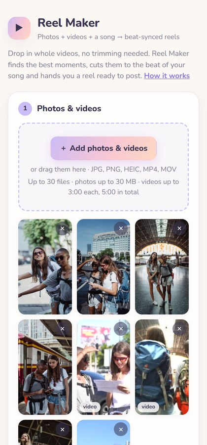
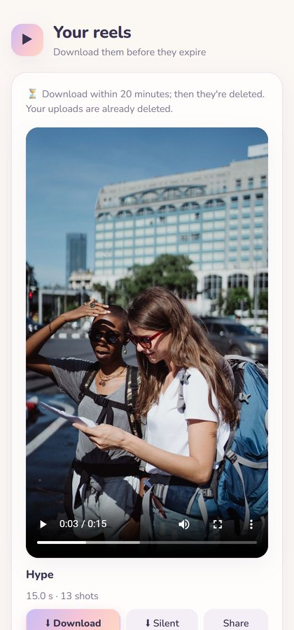

<div align="center">

# Reel Maker

**Drop in whole phone videos and a song. Get back a reel cut to the beat.**

No trimming, no timeline, no AI. Just video and audio analysis with FFmpeg, OpenCV and librosa.

[**Try it at makemyreel.in →**](https://makemyreel.in)

[](https://makemyreel.in)
[](https://github.com/sharmahardik0712/reel-generator/actions/workflows/deploy.yml)
[](engine/pyproject.toml)
[](LICENSE)

</div>

<table align="center">
  <tr>
    <td align="center"><br><sub>Demo (<a href="docs/media/demo.mp4">full video with sound</a>)</sub></td>
    <td align="center"><br><sub>Add photos &amp; videos</sub></td>
    <td align="center"><br><sub>Download your reel</sub></td>
  </tr>
</table>

## Why

Making a Reel usually means trimming every clip by hand and lining the cuts up with
the music yourself. Reel Maker does that part: you add whole, untrimmed clips and it
picks the moments and syncs them to the song.

## What it does

- **Picks the best moments** from long videos: sharp, well-lit and moving, skipping
  blurry or shaky bits and near-duplicate photos.
- **Cuts to the beat:** finds the song's tempo and bars, starts the music at its
  liveliest part, and puts every cut on a beat.
- **Opens strong:** the best shot goes first, then your moments in the order they happened.
- **Handles phone media:** iPhone HEIC photos, HDR (HLG/Dolby Vision) video tone-mapped
  to SDR, rotated and variable-frame-rate clips.
- **Three styles:** Hype (fast cuts), Smooth and Cinematic (longer shots, gentle zooms).
- **Songs from a YouTube link or a name:** the link is only used to read the title; the
  audio is the official 30-second iTunes preview. Or upload your own audio file.
- **Posts cleanly to Instagram:** you get the reel with music and a silent copy, so you
  can add the same song inside Instagram without copyright muting.
- **Private by default:** no account; uploads are deleted as soon as the reel is made,
  and finished reels after 20 minutes.

## How it works

```
photos + videos ─► probe ─► proxies ─► analysis ─┐
                   (HEIC, HDR→SDR,   (sharpness,    ├─► planner ─► edit list ─► render ─► reel.mp4
song ────────────► beats, bars, energy  motion,      │   (pick, order,   (EDL)     (FFmpeg)    + silent copy
                   (librosa)            duplicates) ─┘    time to beats)
```

| Module (`engine/reel_engine/`) | Role |
|---|---|
| `probe.py` | Identify photos/videos/audio by content; size, rotation, HDR, capture time |
| `proxy.py` | HEIC decode, sRGB, HDR→SDR tone-mapping, 30 fps working copies (cached by content hash) |
| `analysis.py` | Sharpness, exposure, colour and detail, motion, scene cuts, perceptual hash |
| `music.py` | Beat tracking with a confidence check and fixed-grid fallback, bars, energy, start point |
| `songs.py` | YouTube link → title (oEmbed) → iTunes Search preview |
| `planner.py` | Varied shot selection (duplicates held back), hook-first ordering, beat-locked timing → EDL |
| `edl.py` | The edit-decision list format and its validator |
| `render.py` | Parallel per-clip rendering, concat, loudness-normalized music, output checks |
| `webapp.py` + `static/` | The web app: chunked uploads, limits, render queue, result pages |
| `presets.yaml` | Pacing and scoring weights for Hype / Smooth / Cinematic |

The planner is deterministic: the same media, settings and seed always give the same reel.

## Run it locally

You need **Python 3.12+** and **FFmpeg** (with `ffprobe`) on your `PATH`. On Windows you
can instead put `ffmpeg.exe` and `ffprobe.exe` in `tools/ffmpeg/`; the gyan.dev
"essentials" build includes `zscale`, which HDR tone-mapping needs.

```bash
python -m venv .venv
.venv/Scripts/pip install -e "engine[dev]"     # macOS/Linux: .venv/bin/pip
.venv/Scripts/reel ui                          # opens http://localhost:8765
```

### Command line

```bash
# find a song from a YouTube link or name, and download its 30 s preview
reel song "https://www.youtube.com/watch?v=4NRXx6U8ABQ" --pick 1

# make reels from a folder (all three styles, 15 s)
reel make path/to/trip --song songs/The-Weeknd-Blinding-Lights.m4a --preset all --out out
```

Other options: `--song-search "artist - song"`, `--length 7|15|30|60`, `--seed N` (a
different variation), `--plan-only` (write the edit list without rendering), and
`reel render out/hype.edl.json` to re-render a saved plan.

## Deploying

[`DEPLOY.md`](DEPLOY.md) covers both options:

- **Cloudflare Containers** (what makemyreel.in runs on): a Worker in front of one
  container, deployed by GitHub Actions on every push to `main`, with safe switch-over
  to new versions.
- **Free, on your own PC:** a `workers.dev` address through Cloudflare Tunnel.

The public site limits each visitor (uploads per hour and day, renders per hour), each
reel (30 files, 5 minutes of video) and each file (photos 30 MB, videos 400 MB and 3 minutes).

## Tests

```bash
.venv/Scripts/python -m pytest engine/tests                                    # everything (~4 min)
.venv/Scripts/python -m pytest engine/tests -m "not ffmpeg and not network"    # fast unit tests
```

The end-to-end tests generate phone-like media (HEIC, rotated video, HLG HDR HEVC,
duplicates, a corrupt file) and a synthetic song with a drop. `engine/tests/golden/`
holds an edit-list snapshot; regenerate it with `UPDATE_GOLDEN=1` after an intended
planner change.

## Project layout

```
engine/                  Python package: the editing engine, CLI and web app
  reel_engine/           probe, proxy, analysis, music, planner, render, webapp
  tests/                 unit, end-to-end and web tests
cloudflare-container/    Worker + container setup for makemyreel.in
cloudflare/              Alternative: Worker for the free home-PC option
scripts/                 Windows helpers (start on login, restart the live site)
Dockerfile               The container image
docs/                    Plan and README media
```

## Ideas and contributing

Issues and pull requests are welcome. Things I'd like to add: letting one long video
supply as many moments as the reel needs, transitions and speed ramps, and keeping
finished reels in Cloudflare R2.

Have a suggestion? Use the email link on [makemyreel.in](https://makemyreel.in), or open an issue.

## Credits

Demo footage and photos: free stock media from [Pexels](https://www.pexels.com).
Demo music: "Upbeat" by prettyjohn1 on [Pixabay](https://pixabay.com/music/electro-upbeat-513865/).

## License

[MIT](LICENSE) © 2026 Hardik Sharma
